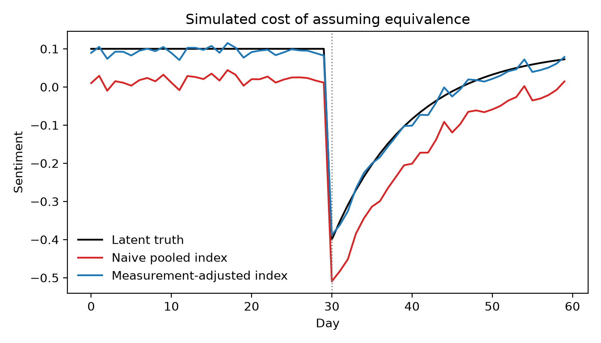
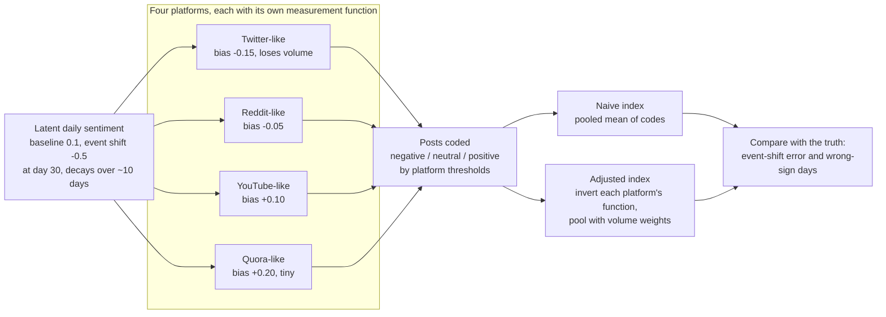

<div align="center">

# Is the Platform Part of the Measurement?

**Simulation code for a protocol that tests whether machine-labelled sentiment means the same thing on every social media platform.**

[](https://doi.org/10.5281/zenodo.23105129)
[](#citation)
[](requirements.txt)
[](LICENSE)
[](#reproduce-the-paper-in-one-minute)

*Asad Ikram and Ella Haig (University of Portsmouth)*

</div>

---

## The problem in one picture

Researchers routinely pool sentiment scores from X, Reddit, YouTube and Quora and read
the difference between platforms as a difference in public opinion. That only works if a
classifier measures the same thing, on the same scale, everywhere. If each platform
"measures" through its own lens, the pooled number can point the wrong way.

<p align="center">
  
</p>

**Figure 1 of the paper.** A known latent sentiment series (black) dips after an event and
recovers. Four simulated platforms observe it through different measurement functions.
The **naive pooled index** (red) averages their coded scores at face value; the
**measurement-adjusted index** (blue) first inverts each platform's measurement function.
Across 500 replications the naive index reports the wrong sign on **13.8 of 60 days**
on average; the adjusted index on **0.8**.

> The adjusted index here uses the *true* measurement functions (an oracle). The paper's
> protocol is about estimating and testing those functions on real data; this repository
> shows what is at stake if you skip that step.

## What the simulation does



Each post expresses `y = latent sentiment + platform bias + noise (sd 0.6)`, and the
platform's two thresholds turn `y` into -1, 0 or +1. Platform volumes drift over the
window, so the platform mix behind the pooled mean changes as it did after real API
restrictions. All parameters are in one table at the top of
[`simulation_study.py`](simulation_study.py); they were fixed before any replication was
run and illustrate the mechanism rather than describe real platforms.

## Reproduce the paper in one minute

```bash
git clone https://github.com/asadfix/platform-measurement.git
cd platform-measurement
python -m venv .venv && source .venv/bin/activate
pip install -r requirements.txt

python simulation_study.py --seed 20261201 --replications 500   # Section 7 numbers + Figure 1
python sensitivity.py                                            # the scenario table below
```

Expected output of the first command, identical on Python 3.11 and 3.14:

```
replications             : 500 (seeds 20261201 to 20261700)
true event shift         : -0.332
naive shift bias         : mean -0.0420  95% [-0.0506, -0.0321]
adjusted shift bias      : mean +0.0013  95% [-0.0072, +0.0107]
naive wrong-sign days    : mean 13.8 of 60  95% [11, 17]
adjusted wrong-sign days : mean 0.8 of 60  95% [0, 2]
single run seed 20261201: true -0.332, naive -0.369, adjusted -0.326, wrong-sign days naive 13, adjusted 0
figure: fig_simulation_demo.png
```

The bracketed ranges are 2.5th to 97.5th percentiles across replications.

## What drives the result

`sensitivity.py` reruns the same 500 seeds under the scenarios Section 7 of the paper
discusses:

| Scenario | Naive shift error | Naive wrong-sign days | Adjusted wrong-sign days |
|---|---|---|---|
| **Published configuration** | -0.042 | **13.8** [11, 17] | 0.8 [0, 2] |
| All platforms share one unbiased, symmetric function | -0.050 | 0.8 [0, 2] | 0.8 [0, 2] |
| Spread between platforms x0.25 | -0.050 | 1.8 [0, 3] | 0.9 [0, 2] |
| Spread between platforms x0.5 | -0.049 | 4.5 [3, 6] | 0.8 [0, 2] |
| Spread between platforms x1.5 | -0.029 | 42.9 [42, 43] | 0.8 [0, 2] |
| Pre-event baseline -0.1 (published: 0.1) | -0.003 | 0.0 [0, 0] | 0.0 [0, 0] |
| Pre-event baseline 0.3 | -0.052 | 2.7 [2, 4] | 0.2 [0, 1] |

Two readings follow, as the paper states:

1. **The shift error is a scale effect, not non-equivalence.** It is no smaller when every
   platform measures identically: it comes from reading three-point codes as if they were
   the latent scale.
2. **The wrong-sign days are the cost of non-equivalence.** They all but vanish when
   platforms measure identically, grow steadily with the spread between platforms, and
   depend on where latent sentiment sits relative to the platforms' net bias. In the
   published configuration they fall mostly in one stretch late in the recovery, where the
   truth has turned slightly positive but the pooled index has not: the naive index dates
   the recovery about two weeks late.

These are properties of one simulated configuration, not bounds on real data.

## The protocol this code supports

The paper proposes six steps before anyone pools sentiment across platforms:

| Step | Question | Method |
|---|---|---|
| 1 | Do platforms diverge on the same event? | Same-event comparison with clustered bootstrap intervals and effect sizes |
| 2 | How reliable is the classifier on each platform? | Fixed-facet generalizability study against human labels |
| 3 | Does the instrument measure the same construct everywhere? | Measurement invariance and differential item functioning, platform as the group |
| 4 | Is divergence explained by timing and composition? | Adjustment within anchor windows |
| 5 | Can platform scales be linked? | Score linking through anchor events fixed in advance |
| 6 | What does assuming equivalence cost? | **This simulation** |

A two-classifier convergence control (a lexicon-seeded and a non-lexicon model) guards
against reading one classifier's quirks as a platform effect.

## Repository map

| File | What it is |
|---|---|
| [`simulation_study.py`](simulation_study.py) | Generating parameters, the two indices, the 500-replication summary and Figure 1. Every function is documented. |
| [`sensitivity.py`](sensitivity.py) | The scenario runs in the table above |
| [`anchor_events.csv`](anchor_events.csv) | The fifteen UK fiscal-policy anchor events (Table 2), fixed on 21 August 2026 before any window count was computed |
| [`keyword_scheme.json`](keyword_scheme.json) | The topic-tagging seed rules of the paper's appendix: topics, priority order, negation rule, gazetteer |
| [`docs/figure1_simulation.png`](docs/figure1_simulation.png) | Figure 1 as published |
| [`CITATION.cff`](CITATION.cff) | Citation metadata (GitHub shows a "Cite this repository" button) |

The anchor-density audit uses two windows per event (48 hours and two weeks), with
inclusion thresholds of 50 and 200 comments per platform-event cell.

## Not included

No social media data. Under the dissertation's ethics and data-management commitments no
raw dataset is shared publicly, and platform and licence terms do not allow raw posts to
be redistributed. Annotation guidelines and aggregated per-event statistics will be added
with the empirical application.

## Citation

If you use this code, please cite the paper and the software:

```bibtex
@misc{ikram2026platform,
  author = {Ikram, Asad and Haig, Ella},
  title  = {Is the Platform Part of the Measurement? A Protocol and Simulation Study
            for Cross-Platform Equivalence of Machine-Labelled Policy Sentiment},
  year   = {2026},
  note   = {arXiv preprint, submitted 12 October 2026}
}

@software{ikram2026platformcode,
  author    = {Ikram, Asad},
  title     = {platform-measurement: simulation study code for
               "Is the Platform Part of the Measurement?"},
  year      = {2026},
  version   = {1.0.0},
  publisher = {Zenodo},
  doi       = {10.5281/zenodo.23105129}
}
```

Zenodo: version 1.0.0 [10.5281/zenodo.23105129](https://doi.org/10.5281/zenodo.23105129) ·
all versions [10.5281/zenodo.23105128](https://doi.org/10.5281/zenodo.23105128).

## Licence

MIT. See [`LICENSE`](LICENSE).
